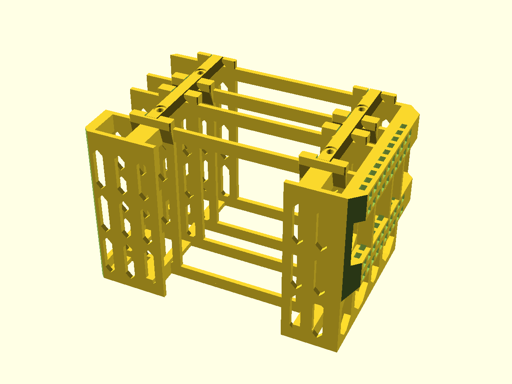
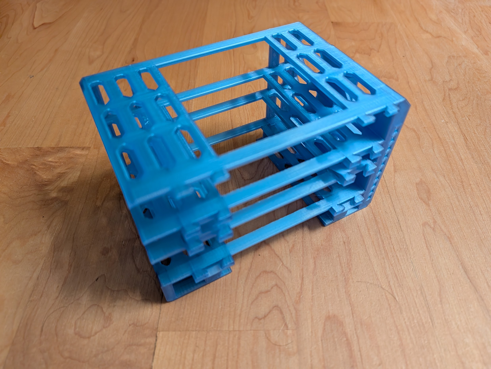
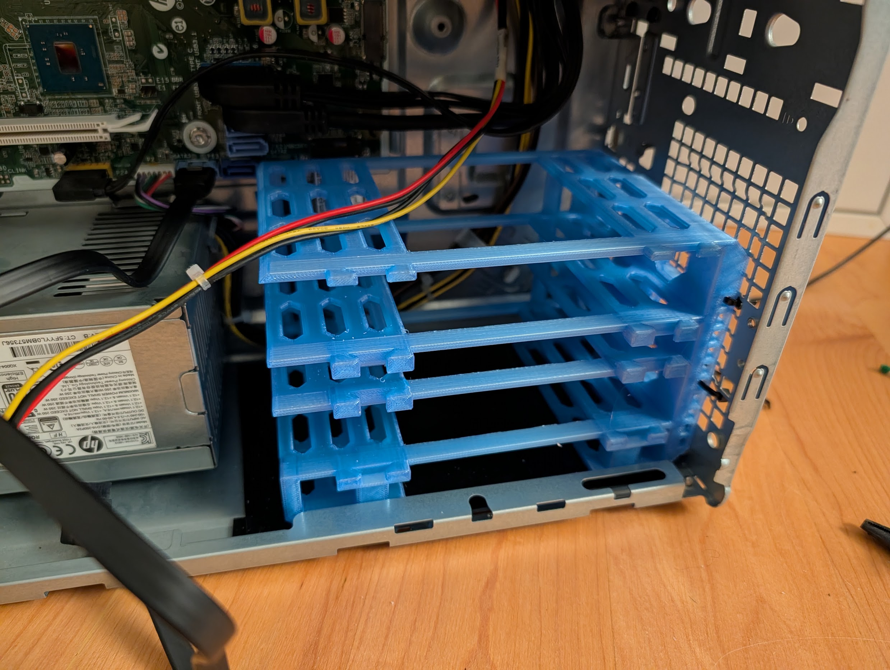
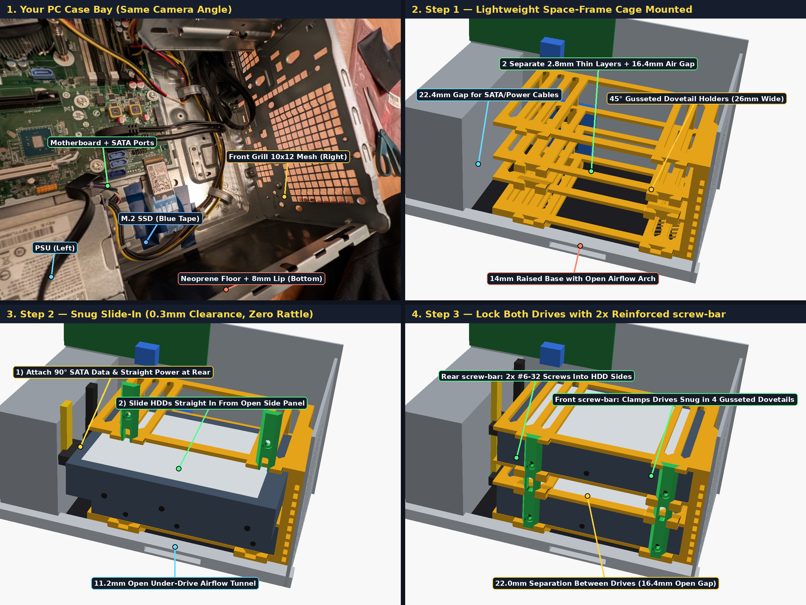
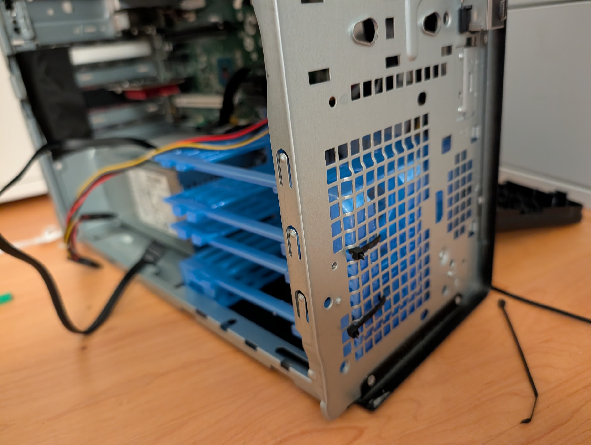
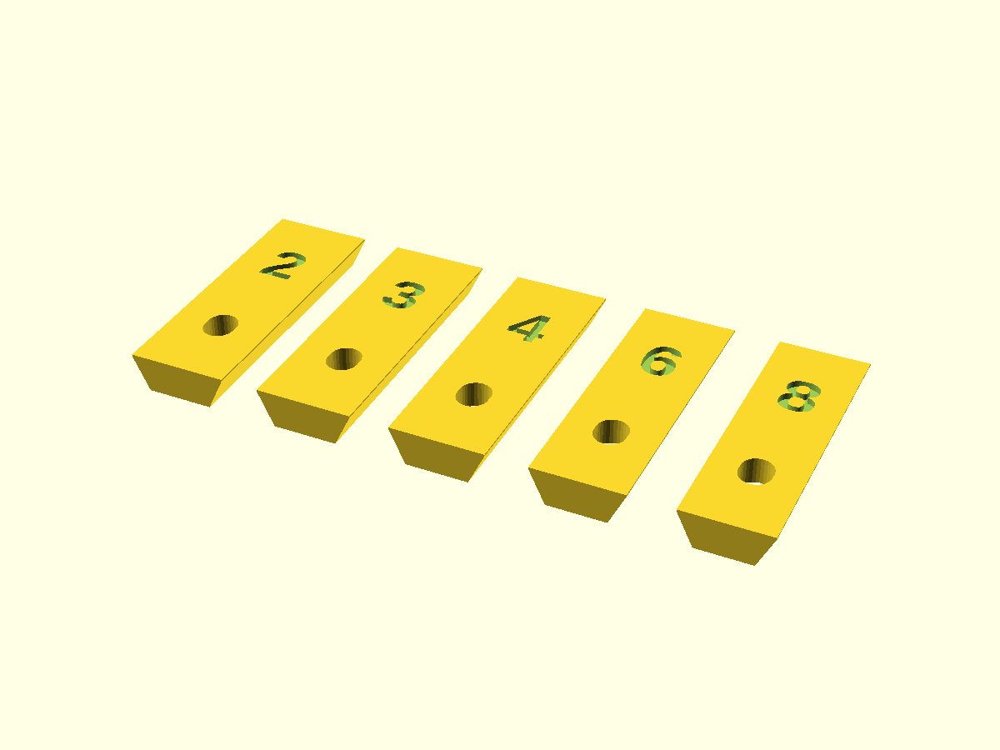
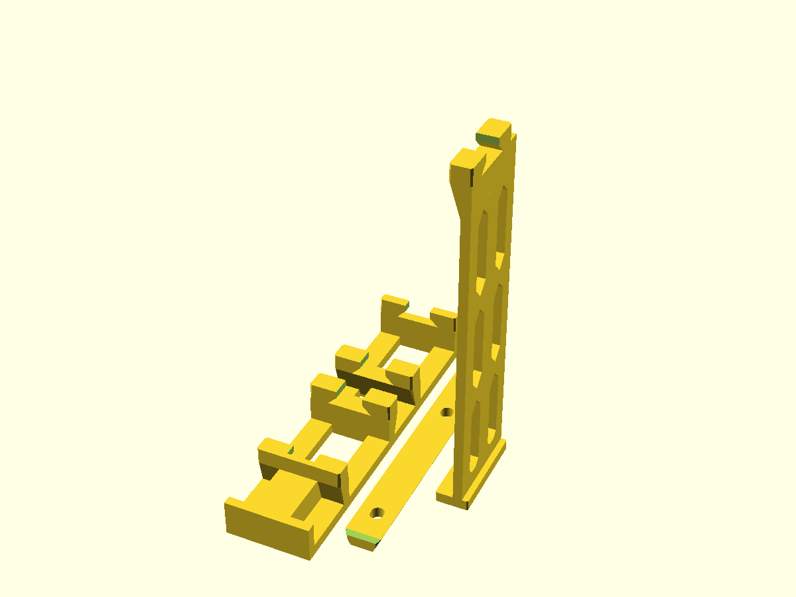
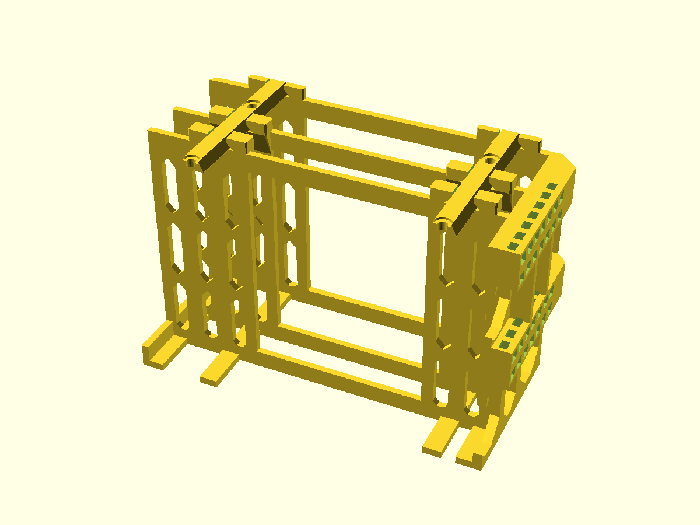

# Parametric 2-Bay 3.5" HDD Space-Frame Enclosure

A lightweight, high-airflow 2-bay 3.5" hard drive space-frame cage for an HP EliteDesk 800 G3 TWR desktop PC (replacing the factory drive cage in the lower-front bay). Designed for support-free FDM printing on Bambu Lab P1S ($256 \times 256 \times 256\text{ mm}$).

---

## From Parametric CAD to Installed Print

| 1. Parametric CAD Model | 2. Completed 3D Print | 3. Installed in PC Bay |
|:---:|:---:|:---:|
|  |  |  |

| Orientation & Assembly Guide | Front Grill Zip-Tie Mounting |
|:---:|:---:|
|  |  |

---

## Ready-to-Print Downloads

Pre-exported production models (ready for Bambu Studio / OrcaSlicer):

| Part | Description | 3MF Download | STL Download |
|---|---|---|---|
| **`print`** | All-in-one plate: full `cage` + 2× `screw-bar` ($171.5 \times 122.9 \times 110.0\text{ mm}$) | [`.3mf`](out/hdd-cage-print.3mf) | [`.stl`](out/hdd-cage-print.stl) |
| **`cage`** | Full 2-bay space-frame enclosure ($162.6 \times 102.0 \times 110.0\text{ mm}$) | [`.3mf`](out/hdd-cage-cage.3mf) | [`.stl`](out/hdd-cage-cage.stl) |
| **`screw-bar`** | Reinforced dovetail locking bar ($10.8 \times 81.5 \times 4.4\text{ mm}$; print 2×) | [`.3mf`](out/hdd-cage-screw-bar.3mf) | [`.stl`](out/hdd-cage-screw-bar.stl) |
| **`test-slice`** | 3-piece fast validation plate ($57.0 \times 102.0 \times 110.0\text{ mm}$) | [`.3mf`](out/hdd-cage-test-slice.3mf) | [`.stl`](out/hdd-cage-test-slice.stl) |
| **`gauge`** | 5-key stepped dovetail clearance gauge ($77.4 \times 34.0 \times 4.4\text{ mm}$) | [`.3mf`](out/hdd-cage-gauge.3mf) | [`.stl`](out/hdd-cage-gauge.stl) |

---

## Engineering Features

* **Lateral Slide-In Over 8 mm Case Lip**: A raised open-arch base ($24.0\text{ mm}$ high with a $21.2\text{ mm}$ tall under-drive airflow tunnel) elevates the bottom 3.5" HDD well above the chassis's $8.0\text{ mm}$ side-panel lip. Both 8TB HGST drives slide straight in laterally from the open side panel with $90^\circ$ SATA data and straight SATA power cables pre-attached.
* **Dual Thin-Layer Inter-Drive Separator**: Replaces a solid mid-wall with two independent $2.8\text{ mm}$ perforated shelf rails separated by a $16.4\text{ mm}$ open air gap ($22.0\text{ mm}$ total drive-to-drive spacing) to maximize convective and front-grill airflow while minimizing filament usage.
* **3-Tier Braced Diamond Vent Rails**: Each horizontal shelf rail subdivides its $87.3\text{ mm}$ vertical span into 3 stacked $26.1\text{ mm}$ diamond vent tiers linked by two $4.5\text{ mm}$ $45^\circ$ horizontal Z-tie bridges. This reduces vertical strut slenderness from $31.2:1$ to $7.0:1$ ($\sim 70\times$ stiffer against lateral nozzle drag), eliminating high-Z column chatter.
* **Gusseted Dovetail `screw-bar` Locking**: Four $26.0\text{ mm}$ wide monolithic dovetail bosses per lock column (backed by $10.0\text{ mm}$ deep $45^\circ$ pyramidal gussets) guide two continuous $81.5\text{ mm}$ `screw-bar` retainers. Four standard `#6-32` UNC HDD screws thread through obround slots in the bars directly into the drives' outer side mounting holes to clamp both drives with zero rattle.
* **Chassis-Matched Front Grill Standoff**: A $12.0\text{ mm}$ open-truss front standoff incorporates two 10-station vertical zip-tie ladders aligned with the PC's $10 \times 12$ square front mesh ($7.25\text{ mm}$ pitch), an $8.0\text{ mm}$ inner setback clearing the $6.0\text{ mm}$ stamped metal tab and rib bumps, and $7.5\text{ mm}$ $45^\circ$ top and bottom corner slices clearing front-wall corner protrusions.

---

## Fit Verification Pieces

To calibrate long-engagement dovetail clearances and verify tall-rail stability before printing the full cage, the model provides dedicated test modes via the `part` selector:

| Part Selector | Description | Image |
|---|---|---|
| **`part = "gauge"`** | 5-key stepped dovetail gauge ($[0.20, 0.30, 0.40, 0.60, 0.80]\text{ mm}$ per-side clearance, engraved `"2"`, `"3"`, `"4"`, `"6"`, `"8"`) with truncated root-relief wings ($4.4\text{ mm}$ height) and `#6-32` screw slots. Key `"8"` ($0.80\text{ mm}$/side) calibrated the production `screw-bar`. |  |
| **`part = "test-slice"`** | 3-piece fast validation plate ($\sim 50\text{ min}$ total or split to individual objects in Bambu Studio): (1) $18\text{ mm}$ shallow 4-boss dual-bay lock frame, (2) full $81.5\text{ mm}$ `screw-bar`, and (3) single-rail $110\text{ mm}$ 3-tier diamond vent tower. |  |
| **`part = "cage"`** | Full production 2-bay space-frame enclosure. |  |

---

## Primary Parameters

Exposed in OpenSCAD Customizer:

| Parameter | Default | Description |
|---|---|---|
| `hdd_l` / `hdd_w` / `hdd_h` | `147.0` / `101.6` / `26.1` | Standard 3.5" SFF-8301 HDD dimensions (mm) |
| `hdd_slide_clr_h` | `0.3` | Vertical clearance in each HDD bay (mm) |
| `hdd_slide_clr_l` | `0.4` | Front-to-rear length clearance in bay (mm) |
| `hdd_slide_clr_w` | `0.2` | Lateral depth clearance before outer lock (mm) |
| `front_standoff` | `12.0` | Front grill to HDD front face distance (mm) |
| `notch_relief_d` | `8.0` | Inner front face setback depth for $6\text{ mm}$ grill tab (mm) |
| `base_h` | `24.0` | Raised open-arch base height under lower HDD (mm) |
| `mid_shelf_h` | `22.0` | Total separation between Bay 1 and Bay 2 (mm) |
| `rail_t` | `2.8` | Thin high-airflow horizontal shelf rail thickness (mm) |
| `wall_t` | `3.2` | Structural frame wall thickness (mm) |
| `dovetail_clr` | `0.80` | Per-side dovetail clearance for `screw-bar` (calibrated via key `"8"`) |
| `screw_hole_d` | `3.8` | `#6-32` UNC screw clearance slot width (mm) |

---

## Printing Recommendations

* **Model File**: [`hdd-cage.scad`](hdd-cage.scad)
* **Material**: PLA or PETG (calibrated and printed cleanly in both; 4 wall loops give near-solid thin rails).
* **Orientation**: Inner motherboard-side skeleton wall flat on the bed ($Z = 0$), shelf rails and $45^\circ$-gusseted dovetail bosses growing vertically to $Z = 110\text{ mm}$. Requires **zero supports**.
* **Walls & Infill**: **4 wall loops**, 5 top / 4 bottom layers, **20% gyroid infill**, 0.20 mm layer height.
* **Bed Adhesion**: 5 mm outer brim recommended on the full `cage` to anchor the open frame corners.
* **Mounting Hardware**: 4× standard `#6-32` UNC HDD screws ($6\text{–}8\text{ mm}$ length) + 2–4× standard zip ties ($\le 4.5 \times 2.0\text{ mm}$) looped through the front chassis grill mesh.

---

## Documentation Links

* [Design Spec (`spec.md`)](spec.md) - Formal engineering specification, case envelope constraints, and assertions.
* [Print Notes (`print-notes.md`)](print-notes.md) - Slicer settings, orientation, and step-by-step fit validation protocol.
* [Repository Root Guide](../../docs/GUIDE.md) - Workflow, setup, and AI pair-programming instructions.
