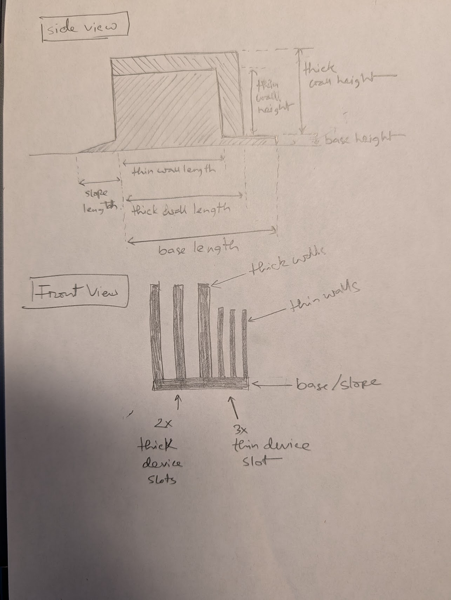
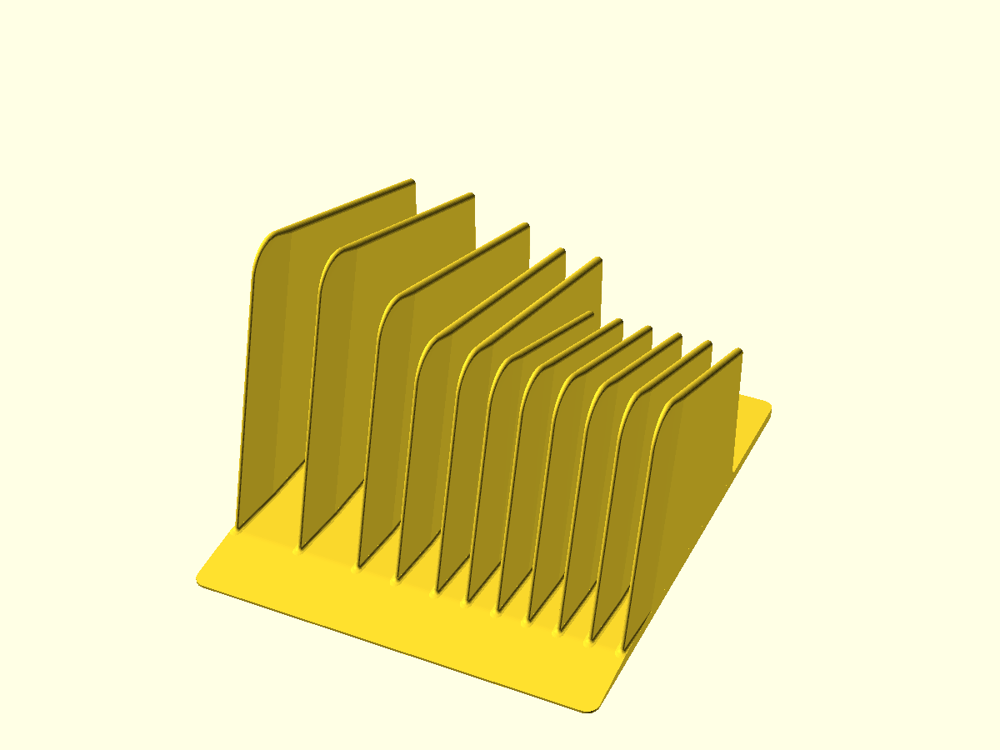
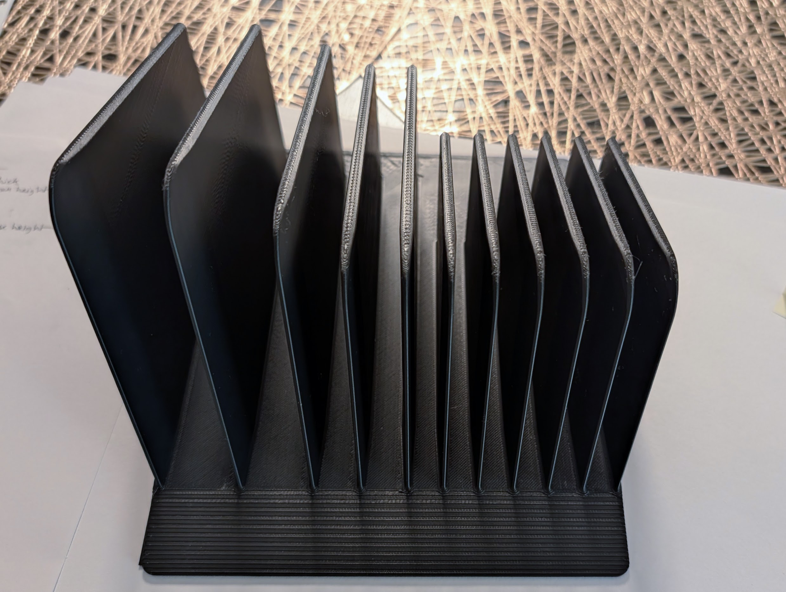
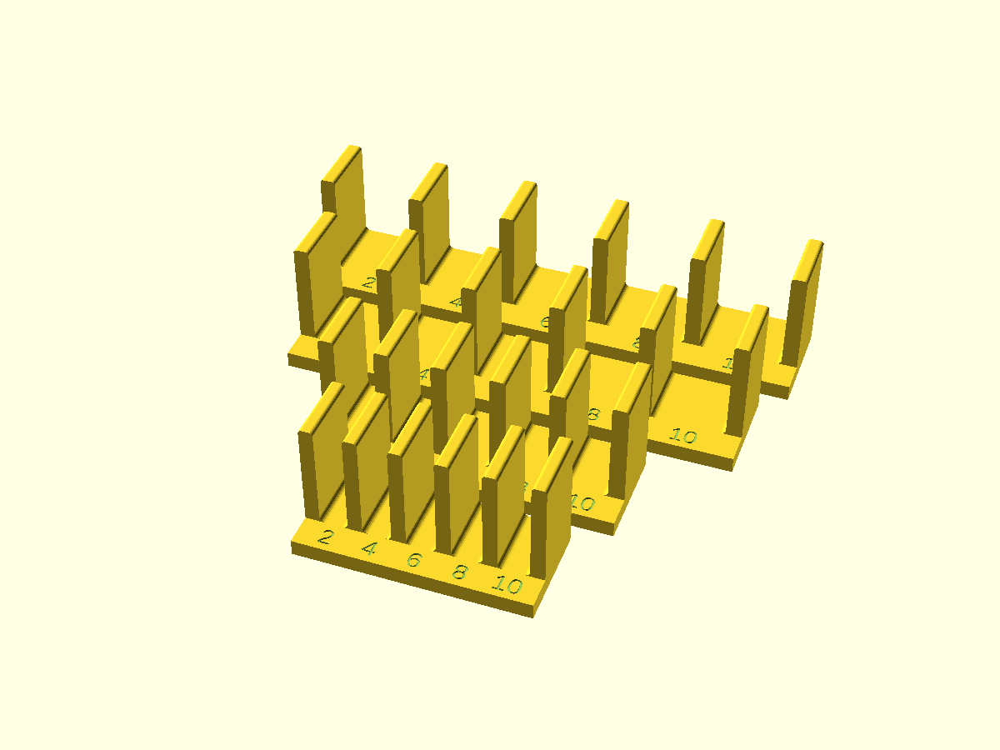

# Parametric Multi-Device Laptop & Tablet Stand

A parametric shelf organizer that holds laptops and tablets upright on their long edges. Designed for FDM printing on Bambu Lab P1S ($256 \times 256 \times 256\text{ mm}$).

---

## From Concept to Physical Print

| 1. Concept Sketch | 2. Parametric CAD Model | 3. Physical Print Output |
|:---:|:---:|:---:|
|  |  |  |

---

## Ready-to-Print Downloads

Pre-exported production models (ready for Bambu Studio / OrcaSlicer):

| Part | Description | 3MF Download | STL Download |
|---|---|---|---|
| **`stand`** | Full production stand ($170.7 \times 205 \times 120\text{ mm}$; 4 thick + 6 thin slots) | [`.3mf`](out/laptop-holder-stand.3mf) | [`.stl`](out/laptop-holder-stand.stl) |
| **`gauge`** | Stepped slot clearance gauge plate ($144.3 \times 131 \times 35\text{ mm}$) | [`.3mf`](out/laptop-holder-gauge.3mf) | [`.stl`](out/laptop-holder-gauge.stl) |
| **`test-slice`** | Front entry & ramp test slice ($89.6 \times 80 \times 45\text{ mm}$) | [`.3mf`](out/laptop-holder-test-slice.3mf) | [`.stl`](out/laptop-holder-test-slice.stl) |

---

## Engineering Features

* **Custom Slot Sizing**: Supports distinct widths per slot (e.g. $[22.86, 20, 11, 11]\text{ mm}$ thick devices) alongside a dedicated group of thin tablet slots.
* **Lead-in Ramp & Overhang Stop**: Front $30\text{ mm}$ ramp ($7.6^\circ$ incline, $20\text{ mm}$ fillet blend) allows smooth horizontal slide-in on shelves with limited vertical clearance. Devices overhang $30\text{ mm}$ in front of the walls, landing flush with the ramp front lip.
* **Tapered & Raked Leading Edges**:
  * Wall fronts taper linearly over $25\text{ mm}$ in plan to a $1.6\text{ mm}$ rounded tip, widening the entry opening by $\sim 2.5\text{ mm}$ per slot.
  * Front edges rake backward $15^\circ$ so device bottoms enter the slot before the top edges touch.
* **Continuous Root Fillets**: $1.5\text{ mm}$ concave fillets wrap entirely around the wall footprint (front nose, sides, and rear) to distribute lateral bending loads and eliminate catch notches.
* **Mass & Filament Optimization**: Sloped wall tops ($0.7$ rear height ratio) reduce height toward the rear where support is not needed.

---

## Fit Verification Pieces

To dial in clearances before printing the full stand, the model provides dedicated test modes via the `part` selector:

| Part Selector | Description | Image |
|---|---|---|
| **`part = "gauge"`** | Stepped slot gauge plate with 4 separate bars (one per device thickness). Each bar provides 5 clearance slots ($[0.2, 0.4, 0.6, 0.8, 1.0]\text{ mm}$) with engraved tenths labels to select clearances empirically. |  |
| **`part = "test-slice"`** | Short front section ($80\text{ mm}$ long, $40\text{ mm}$ walls) with one slot per unique thickness to test entry ramp transitions, nose feel, and slide-in friction. | |
| **`part = "stand"`** | Full production stand. | |

---

## Primary Parameters

Exposed in OpenSCAD Customizer:

| Parameter | Default | Description |
|---|---|---|
| `thick_device_widths` | `[22.86, 20, 11, 11]` | Caliper-measured maximum thicknesses (mm) |
| `thick_clearance` | `1.64` | Total slot clearance for thick devices (mm) |
| `thick_wall_heights` | `[115, 103, 91, 91]` | Front wall height per thick slot ($\sim 45\%$ of device height) |
| `thin_device_count` | `6` | Number of thin tablet slots |
| `thin_slot_width` | `8.8` | Slot width for thin devices ($7.60\text{ mm} + 1.20\text{ mm}$ clearance) |
| `slope_length` | `30` | Lead-in ramp length (= device front overhang) |
| `nose_rake` | `15` | Backward rake angle of wall fronts (degrees) |
| `nose_taper_length` | `25` | Length of front wall nose taper (mm) |
| `root_fillet_r` | `1.5` | Radius of wall-to-floor root fillet (mm) |

---

## Printing Recommendations

* **Model File**: [`laptop-holder.scad`](laptop-holder.scad)
* **Orientation**: Base flat on bed ($Z=0$), walls vertical. Requires zero supports.
* **Wall Generator**: **Arachne** with **6 wall loops** (ensures divider walls print $100\%$ solid without gap-fill vibration).
* **Layer Height**: 0.20 mm Standard.
* **Infill**: 15% gyroid (in base slab).
* **Surface Finish**: Ironing enabled on top surfaces (ramp and slot floors) for smooth device sliding.

---

## Documentation Links

* [Design Spec (`spec.md`)](spec.md) - Formal engineering specification, assertions, and derived geometry.
* [Print Notes (`print-notes.md`)](print-notes.md) - Slicer profiles and stepped gauge test protocol.
* [Initial Idea & Sizing (`ref/idea.md`)](ref/idea.md) - Device measurements and tipping center calculations.
* [Repository Root Guide](../../docs/GUIDE.md) - Workflow, setup, and AI pair-programming instructions.
