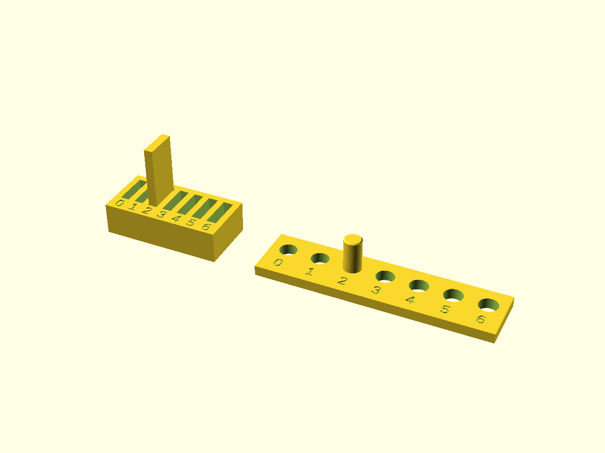

# Tolerance Coupon

Empirical calibration tool to measure real-world clearances for FDM printing on Bambu Lab P1S (0.4 mm nozzle). Used to populate measured clearance values in [`lib/common/tolerances.scad`](../../lib/common/tolerances.scad).

---

## Ready-to-Print Downloads

Pre-exported production models (sliced for 0.4 mm nozzle, 0.20 mm layer height):

| Part | Description | 3MF Download | STL Download |
|---|---|---|---|
| **All-in-One Plate** | All 4 parts laid flat with $\ge 5\text{ mm}$ spacing | [`.3mf`](out/tolerance-coupon-print.3mf) | [`.stl`](out/tolerance-coupon-print.stl) |
| **`key`** | $40 \times 15 \times 4.0\text{ mm}$ reference bar | [`.3mf`](out/tolerance-coupon-key.3mf) | [`.stl`](out/tolerance-coupon-key.stl) |
| **`slot-block`** | 7 test slots ($4.0\text{ mm} + [0.0 \dots 0.6]\text{ mm}$) | [`.3mf`](out/tolerance-coupon-slot-block.3mf) | [`.stl`](out/tolerance-coupon-slot-block.stl) |
| **`pin`** | $\varnothing 8.0 \times 20\text{ mm}$ cylinder | [`.3mf`](out/tolerance-coupon-pin.3mf) | [`.stl`](out/tolerance-coupon-pin.stl) |
| **`hole-plate`** | 7 test holes ($\varnothing 8.0 + [0.0 \dots 0.6]\text{ mm}$) | [`.3mf`](out/tolerance-coupon-hole-plate.3mf) | [`.stl`](out/tolerance-coupon-hole-plate.stl) |

---

## Overview

FDM clearances vary across materials, slicer settings, and printer mechanics. This coupon provides standardized test geometry to measure slot and hole fits:

| Part | Geometry | Evaluation |
|---|---|---|
| **`key`** | $40 \times 15 \times 4.0\text{ mm}$ rectangular bar | Printed flat on bed ($4.0\text{ mm}$ along $Z$). Measured post-print with calipers to establish baseline thickness. |
| **`slot-block`** | 7 slots with nominal $4.0\text{ mm} + [0.0, 0.1, 0.2, 0.3, 0.4, 0.5, 0.6]\text{ mm}$ widths, $12\text{ mm}$ deep | Insert printed `key` to evaluate slot friction and fit class. |
| **`pin`** | $\varnothing 8.0 \times 20\text{ mm}$ cylinder | Printed upright with $0.4\text{ mm}$ bed chamfer. Measured post-print with calipers to establish baseline diameter. |
| **`hole-plate`** | 7 through-holes with $\varnothing 8.0 + [0.0, 0.1, 0.2, 0.3, 0.4, 0.5, 0.6]\text{ mm}$ | Insert printed `pin` to evaluate cylindrical fit class. |

---

## Measured Baseline (Bambu PLA Basic)

Tested on Bambu Lab P1S with 0.20 mm layer height and default flow calibration:

| Feature | Fit Class | Measured Clearance | Notes |
|---|---|---|---|
| **Hole** ($\varnothing$) | `press` | $+0.10\text{ mm}$ | Firm insertion, remains fixed |
| | `snug` | $+0.20\text{ mm}$ | Friction hold, removable by hand |
| | `slide` | $+0.30\text{ mm}$ | Smooth axial travel, minimal play |
| | `free` | $+0.40\text{ mm}$ | Loose fit with noticeable clearance |
| **Slot** (width) | `snug` | $+0.05\text{ mm}$ | Light friction hold |
| | `slide` | $+0.10\text{ mm}$ | Smooth slide without binding |
| | `free` | $+0.20\text{ mm}$ | Free entry |

---

## Print & Usage

* **Model File**: [`tolerance-coupon.scad`](tolerance-coupon.scad)
* **Modes**: `part = "assembly"` (review/section), `"print"` (all 4 parts flat on bed with $\ge 5\text{ mm}$ spacing), or individual part names (`"key"`, `"slot-block"`, `"pin"`, `"hole-plate"`).
* **Slicer Settings**: 0.20 mm layer height, 3 wall loops, 5 top / 4 bottom layers, 15% gyroid infill, no supports.
* **Fit Test Protocol**: Measure actual printed key/pin with digital calipers, insert into slots/holes 0–6, and record observations in the log.

---

## Documentation Links

* [Detailed Spec (`spec.md`)](spec.md) - Exact CAD dimensions, assertions, and geometric definitions.
* [Print Notes (`print-notes.md`)](print-notes.md) - Slicing parameters, bed adhesion, and fit test protocol.
* [Repository Root Guide](../../docs/GUIDE.md) - Toolchain setup and workflow.
